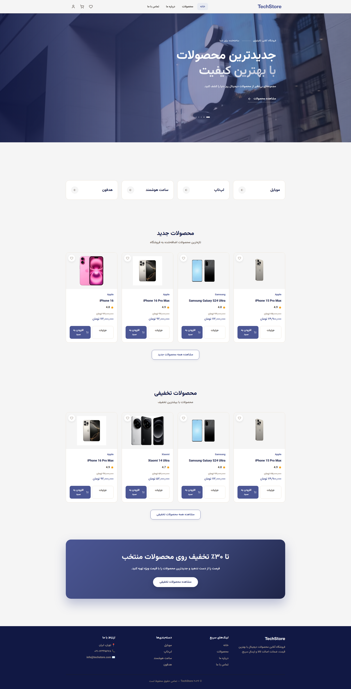

# TechStore 🛒

### Modern React E-Commerce Platform

TechStore is a fully responsive, RTL-first e-commerce storefront built with **React, Vite, and the Context API**. It simulates a real online shop — from product discovery and cart management to checkout, order history, and a full admin dashboard for managing products, orders, and users.

Built as a portfolio project with a focus on **realistic app structure, protected routing, role-based access control, and clean separation of business logic from UI.**

---

## 🚀 Live Demo

[View Live Demo](#) <!-- add your Netlify/Vercel link here -->

---

## ✨ Features

### 🛍️ Shopping Experience
- Product catalog with filtering and sorting
- Product details page with specs, related products, and reviews
- Shopping cart with quantity management
- Favorites / wishlist
- Coupon codes (percentage and fixed-amount discounts)
- Multi-step checkout (address → payment method → order summary)
- Order success / confirmation page

### 👤 Authentication & Accounts
- Register / Login / Logout (mock, client-side)
- Forgot password flow
- Protected routes for checkout, order confirmation, and profile
- Profile management (edit info, change password, order history)

### 🛠️ Admin Dashboard
- Role-based access control (`RequireAdmin`) — separate from regular `RequireAuth`
- Manage products, categories, and orders
- Manage users: change roles, delete accounts (with safeguards against removing the last admin or your own account)
- Analytics tab

### ⭐ Reviews
- Star-rating reviews per product, restricted to users who purchased the item
- Users can edit or delete their own review

### 🌍 RTL & Persian UI
- Fully right-to-left interface
- Persian number and currency formatting (Toman)
- Responsive layouts for mobile, tablet, and desktop

---

## 🛠️ Tech Stack

| Technology | Purpose |
|---|---|
| React 19 | UI and component architecture |
| Vite | Development and build tooling |
| React Router DOM | Routing, protected routes, code-splitting |
| Context API | Global state (Auth, Cart, Favorites, Products, Categories, Orders, Reviews) |
| Lucide React | Icons |
| Custom CSS | Design system (variables, components) |
| localStorage | Mock persistence layer |

---

## 🏗️ Architecture

```
src/
├── components/
│   ├── admin/        → admin dashboard tabs (products, orders, users, analytics)
│   ├── checkout/      → address form, payment method, order summary
│   ├── product/       → product card, filters, gallery, reviews, specs
│   ├── profile/       → profile info, password change, order history
│   └── layout/        → navbar, footer, layout shell
│
├── context/            → Auth, Cart, Favorites, Products, Categories, Orders, Reviews
├── pages/               → route-level pages
├── services/            → business logic isolated from components (e.g. couponService)
├── hooks/               → shared hooks (useCheckout, usePageTitle)
├── utils/                → formatPrice, storage, constants, order status helpers
├── data/                 → seed/mock product data
├── models/               → shared type/shape documentation
├── styles/               → design tokens + component styles
└── routes.jsx            → central route definitions with lazy-loaded pages
```

### Route Protection

Two separate guard components exist by design:

- **`RequireAuth`** — any logged-in user (checkout, order confirmation, profile)
- **`RequireAdmin`** — logged-in **and** `role === "admin"` (the `/admin` dashboard). Unlike `RequireAuth`'s silent redirect, an authenticated non-admin sees an explicit "Access Restricted" message rather than being redirected — a silent redirect here would look like a bug rather than a permissions boundary.

---

## ⚠️ Project Scope & Limitations

TechStore is a portfolio project and intentionally uses a mock data/auth layer instead of a production backend:

- No real backend — data lives in `localStorage`
- **Mock authentication**: passwords are stored in plain text client-side. This is explicitly *not* production-safe and is called out in code comments in `AuthContext.jsx` — in a real app, auth must go through a backend API with hashed passwords (e.g. bcrypt) and token-based sessions, never plaintext password storage.
- A default admin account (`admin@techstore.com` / `admin123`) is seeded automatically since there's no UI flow to promote a user to admin — in a real app, role assignment would be a backend-controlled operation.
- Coupon codes are hardcoded client-side; a real store would validate them server-side.
- Static/seeded product catalog — no real inventory or payment gateway.

These limitations are intentional: the goal is to demonstrate frontend architecture, state management, and UX flows without introducing unnecessary backend complexity.

---

## 🚀 Getting Started

```bash
# Clone the repository
git clone https://github.com/mina-gharzi/techstore-react.git

# Navigate to the project folder
cd techstore-react

# Install dependencies
npm install

# Start the development server
npm run dev
```

The app will be available at `http://localhost:5173`.

**Demo admin login:** `admin@techstore.com` / `admin123`

---

## 📌 Future Improvements

- Real backend integration (auth, products, orders)
- Real payment gateway
- Server-side coupon validation
- Advanced search
- Product review moderation for admins

---

## 👩‍💻 Author

**Mina Gharzi**
Frontend Developer focused on building modern, accessible, and scalable web applications with React.

---

## 📄 License

This is a personal portfolio project and is not licensed for commercial reuse.
# TechStore

An online electronics store built with React: browse and filter products, add to cart, check out, manage your account, and run the shop from an admin panel. Persian-first (RTL) interface.

This was **my first React project**. It is written in plain JavaScript with the Context API, before I moved to TypeScript and more structured state management in my later projects.



> **This is a front-end project with no backend.** Users, products, orders and carts live in `localStorage`. Authentication is fake: passwords are stored in plain text in the browser, so **never use a real password**. Roles are checked in the UI only.

**Built with:** React · JavaScript (JSX) · Vite · React Router · Context API · lucide-react · Vitest

## Try it

- **Admin:** `admin@techstore.com` with password `admin123` (seeded automatically)
- **Customer:** register a new account, or use the admin account to see both sides
- **Coupons:** `WELCOME10` gives 10% off, `TECH50` takes 5,000,000 toman off the cart

## What it does

**Shopping**
- Product list with filtering and sorting, product pages with specs, reviews and related products
- Cart that survives reloads; a guest cart is merged into your account when you log in
- Favorites list
- Checkout with validated shipping details (mobile number and 10-digit postal code), payment method choice, coupon codes, and a stock check before the order is placed
- Order confirmation, and stock is reduced when an order is placed

**Account**
- Register, log in, edit your profile, change your password, reset a forgotten password
- Order history in your profile

**Admin panel** (admin role only)
- Tabs for products, orders, users, categories and analytics
- Add, edit and delete products and categories; update order statuses
- User management with safeguards: you cannot delete your own account or the last remaining admin

## How it is built

- **Context per feature:** separate providers for auth, cart, products, categories, favorites, orders and reviews
- **The cart stores only product ids and quantities.** Prices and stock are read from the live product data, so a price or stock change is reflected immediately instead of leaving stale copies in the cart
- **Business logic outside components:** checkout rules live in the `useCheckout` hook and coupons in `couponService`, so the page components stay mostly presentational
- **Code splitting:** heavy pages (admin, product details, checkout, profile) load lazily, and an error boundary catches rendering errors
- **Safe storage helpers:** reads and writes to `localStorage` are wrapped so a corrupted value or blocked storage cannot crash the app

## Testing

Vitest unit tests cover the pure logic: coupon validation and discount rules (including capping a fixed discount at the cart total) and price formatting.

```bash
npx vitest run
```

## Known limitations and what I would change

- No real backend: a real version needs server-side authentication with hashed passwords, and server-side price, stock and permission checks
- "Forgot password" only asks for an email and phone number, which is fine for a demo but not secure
- Only the pure logic is tested; the pages and the checkout flow have no automated tests yet
- A TypeScript migration would catch a whole class of data-shape bugs in the contexts

## Getting started

Requirements: Node.js 20+.

```bash
git clone https://github.com/mina-gharzi/techstore-react.git
cd techstore-react
npm install
npm run dev
```

## Project structure

```
src/pages/       route-level screens
src/components/  UI grouped by feature (product, checkout, admin, profile, layout)
src/context/     feature state: auth, cart, products, orders, favorites, reviews, categories
src/hooks/       useCheckout and other hooks
src/services/    coupon logic
src/utils/       formatting, storage, order status helpers
src/styles/      CSS variables and component styles
```

## License

This is a personal portfolio project and is not licensed for commercial reuse.